# Asignación 3 — Monitoreo SNMP de solo lectura con Zabbix

**Jose Gabriel Feliz Maria · Matrícula: 2025-0742**
**Seguridad de Redes · ITLA**

---

## 🎥 Video Demostrativo

**[Ver demostración en YouTube](PENDIENTE_LINK_VIDEO)**

En el video se muestra la hora y fecha del sistema, el rostro y la voz del autor, y la demostración de que la topología cumple su objetivo: el servidor Zabbix recibe su IP por DHCP, lee por SNMP los datos del router y del switch (interfaces, tráfico, CPU, memoria) y nadie más puede hacerlo: la comunidad es de solo lectura, no es `public` y una ACL solo deja consultar al Zabbix.

---

## 📋 Tabla de Contenido

1. [Propósito del Laboratorio](#1-propósito-del-laboratorio)
2. [Topología](#2-topología)
3. [Direccionamiento IP](#3-direccionamiento-ip)
4. [Decisiones de Diseño y Seguridad](#4-decisiones-de-diseño-y-seguridad)
5. [R1: Direccionamiento, DHCP y SNMP](#5-r1-direccionamiento-dhcp-y-snmp)
6. [SW1: VLAN, Gestión y SNMP](#6-sw1-vlan-gestión-y-snmp)
7. [Servidor Zabbix (Kali + Docker)](#7-servidor-zabbix-kali--docker)
8. [Configuración en Zabbix (GUI)](#8-configuración-en-zabbix-gui)
9. [Datos SNMP en Zabbix](#9-datos-snmp-en-zabbix)
10. [Pruebas y Verificación](#10-pruebas-y-verificación)
11. [Problemas Encontrados y Soluciones](#11-problemas-encontrados-y-soluciones)
12. [Scripts y Running-Configs](#12-scripts-y-running-configs)
13. [Evidencias (Capturas)](#13-evidencias-capturas)
14. [Notas y Limitaciones del Laboratorio](#14-notas-y-limitaciones-del-laboratorio)

---

## 1. Propósito del Laboratorio

Monitorear los equipos de red desde un servidor central **sin abrirles una puerta nueva a un atacante**. El router y el switch publican su estado por **SNMP** (interfaces, tráfico, errores, CPU, memoria, tiempo encendido, datos del hardware) y un servidor **Zabbix** los consulta cada minuto, los guarda y los muestra en gráficas y alertas.

Lo que pide la asignación:

**Router y switch**

1. Direccionamiento IP.
2. Servidor DHCP para la red LAN.
3. Comunidad SNMP de **solo lectura**.

**Servidor Zabbix**

4. Cliente DHCP.
5. Verificar en Zabbix los datos SNMP del router y del switch.

El objetivo de seguridad es que **solo el Zabbix** pueda leer esos datos y que **nadie** pueda cambiar la configuración por SNMP.

---

## 2. Topología

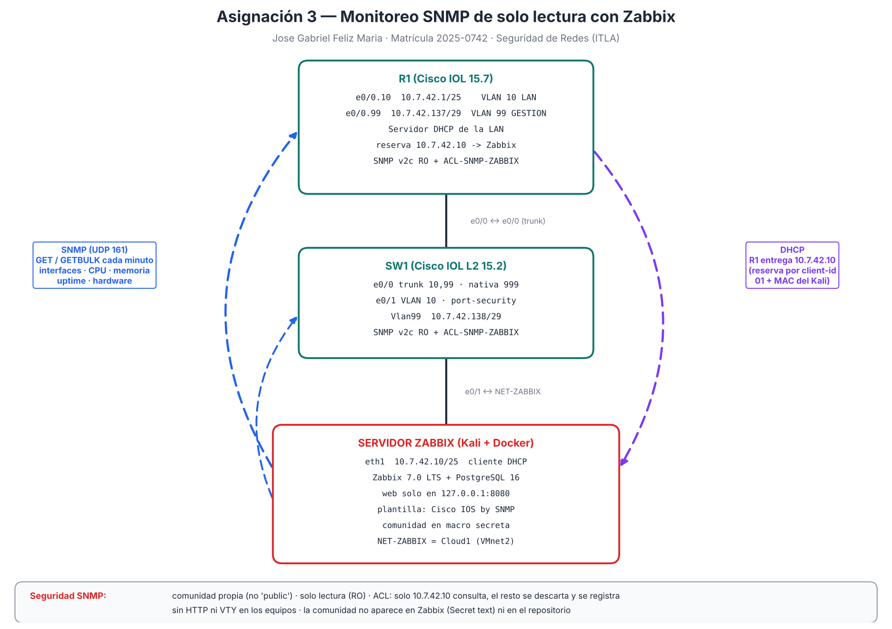

Topología montada en PNETLab:

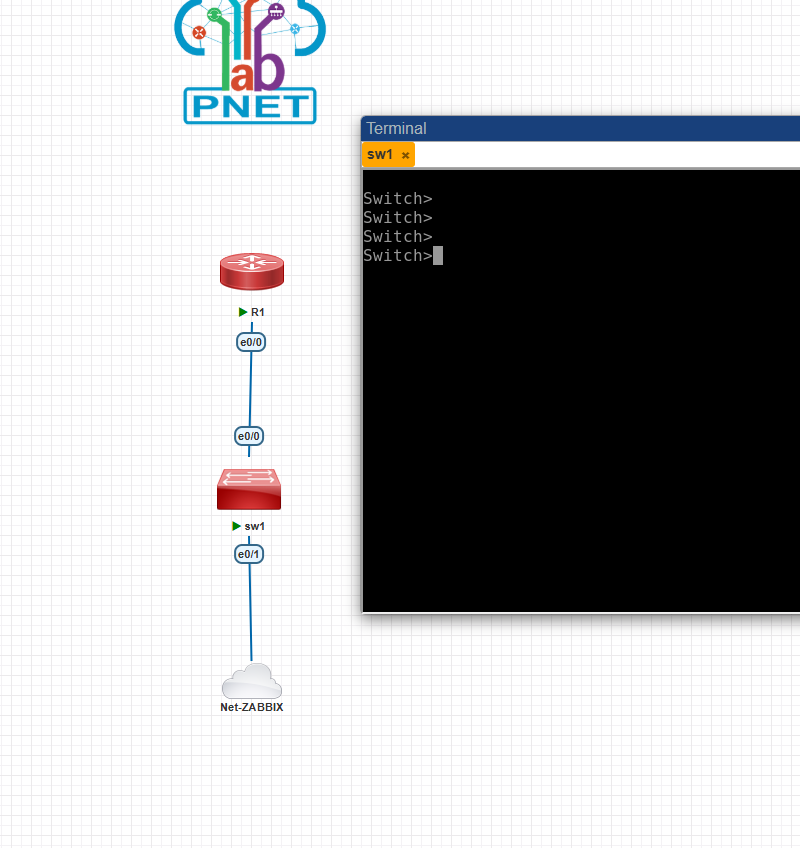

| Equipo | Rol |
|---|---|
| **R1** | Router Cisco IOL 15.7. Router-on-a-stick por `e0/0` entre la VLAN 10 (LAN) y la VLAN 99 (gestión), servidor DHCP de la LAN y agente SNMP |
| **SW1** | Switch Cisco IOL L2 15.2. Conecta el servidor Zabbix (VLAN 10) y lleva las dos VLAN al R1 por un trunk; agente SNMP con IP de gestión en la VLAN 99 |
| **Servidor Zabbix** | VM Kali con Docker: Zabbix 7.0 LTS (server + web) y PostgreSQL 16. Su `eth1` (VMnet2) llega al lab por la nube **NET-ZABBIX** (Cloud1) y pide IP por DHCP |

---

## 3. Direccionamiento IP

| VLAN | Nombre | Red | Gateway (R1) | Equipos |
|---|---|---|---|---|
| 10 | LAN | `10.7.42.0/25` | `10.7.42.1` | Servidor Zabbix `10.7.42.10` (DHCP, reserva por MAC) · pool `10.7.42.10 – .126` |
| 99 | GESTION | `10.7.42.136/29` | `10.7.42.137` | SW1 `Vlan99` `10.7.42.138` |
| 999 | SIN-USO | — | — | VLAN nativa del trunk y puertos sin uso (apagados) |

| Equipo | Interfaz | Dirección |
|---|---|---|
| R1 | `e0/0.10` / `e0/0.99` | `10.7.42.1/25` / `10.7.42.137/29` |
| SW1 | `Vlan99` | `10.7.42.138/29` · gateway `10.7.42.137` |
| Zabbix (Kali) | `eth1` | `10.7.42.10/25` por DHCP · ruta a `10.7.42.136/29` por `10.7.42.1` |
| Zabbix (Kali) | `eth0` | Bridged, solo para descargar las imágenes de Docker (no toca el lab) |

---

## 4. Decisiones de Diseño y Seguridad

- **SNMP v2c de solo lectura (`RO`).** Zabbix solo necesita leer. Con `RO`, aunque alguien tenga la comunidad, no puede cambiar nada (prueba 12: `noAccess`).
- **Comunidad propia, no `public`.** Es una cadena aleatoria de 20 caracteres. No aparece en el repositorio, ni en el video, ni en la pantalla de Zabbix.
- **ACL `ACL-SNMP-ZABBIX`.** Solo `10.7.42.10` (el Zabbix) puede consultar; cualquier otra IP se descarta aunque tenga la comunidad correcta (prueba 14), y queda registrada (`deny any log`).
- **Gestión separada.** El SW1 se administra por la VLAN 99, no por la LAN; para llegar a él hay que pasar por el R1.
- **Reserva DHCP.** El Zabbix siempre recibe `10.7.42.10`, que es la IP que permite la ACL. La reserva usa el `client-identifier` (`01` + MAC), y en el Kali el perfil de red manda ese mismo identificador (`ipv4.dhcp-client-id mac`).
- **Sin administración por red en los equipos.** `no ip http server` y `transport input none` en las VTY: la única forma de configurarlos es la consola. SNMP es solo de lectura.
- **Zabbix endurecido.** La interfaz web solo escucha en `127.0.0.1:8080` (no se publica a la red); la clave por defecto de `Admin` se cambió; la comunidad se guarda en la macro `{$SNMP_COMMUNITY}` como **Secret text**; y la clave de PostgreSQL se genera al azar en `~/zabbix-a3/.env` con permisos `600`.
- **SW1 con port-security** en el puerto del servidor (máximo 4 MAC, sticky, `restrict`), `portfast` y `bpduguard`; puertos sin uso apagados en la VLAN 999.

---

## 5. R1: Direccionamiento, DHCP y SNMP

Configuración completa en [`scripts/R1_config.txt`](scripts/R1_config.txt).

```
interface Ethernet0/0.10
 description VLAN10-LAN
 encapsulation dot1Q 10
 ip address 10.7.42.1 255.255.255.128
interface Ethernet0/0.99
 description VLAN99-GESTION
 encapsulation dot1Q 99
 ip address 10.7.42.137 255.255.255.248
!
ip dhcp excluded-address 10.7.42.1 10.7.42.9
ip dhcp pool LAN-VLAN10
 network 10.7.42.0 255.255.255.128
 default-router 10.7.42.1
ip dhcp pool ZABBIX
 host 10.7.42.10 255.255.255.128
 client-identifier 0100.0c29.a89b.d3
 default-router 10.7.42.1
!
ip access-list standard ACL-SNMP-ZABBIX
 remark Solo el servidor Zabbix puede consultar SNMP
 permit host 10.7.42.10
 deny any log
snmp-server community <COMUNIDAD_SNMP> RO ACL-SNMP-ZABBIX
snmp-server location PNETLab - Laboratorio A3 - ITLA
snmp-server contact Jose Gabriel Feliz Maria - 2025-0742
snmp-server ifindex persist
logging buffered 64000 informational
```

- `snmp-server ifindex persist` mantiene el número de cada interfaz aunque el equipo se reinicie, para que el historial de Zabbix no se mezcle.
- `logging buffered ... informational` guarda en el R1 los intentos bloqueados por la ACL (`%SEC-6-IPACCESSLOGNP`).

---

## 6. SW1: VLAN, Gestión y SNMP

Configuración completa en [`scripts/SW1_config.txt`](scripts/SW1_config.txt).

```
interface Ethernet0/0
 description TRUNK-R1-e0/0
 switchport trunk encapsulation dot1q
 switchport mode trunk
 switchport trunk native vlan 999
 switchport trunk allowed vlan 10,99
 switchport nonegotiate
interface Ethernet0/1
 description SERVIDOR-ZABBIX (Kali - NET-ZABBIX)
 switchport mode access
 switchport access vlan 10
 switchport port-security maximum 4
 switchport port-security violation restrict
 switchport port-security mac-address sticky
 switchport port-security
 spanning-tree portfast edge
 spanning-tree bpduguard enable
interface Vlan99
 ip address 10.7.42.138 255.255.255.248
no ip routing
ip default-gateway 10.7.42.137
```

La parte de SNMP es igual que en el R1 (misma ACL, misma comunidad `RO`). En IOL L2 hace falta `no ip routing` para que el switch use `ip default-gateway` y pueda responder a la VLAN 10.

---

## 7. Servidor Zabbix (Kali + Docker)

### 7.1 Cliente DHCP

La `eth1` del Kali (VMnet2 → nube NET-ZABBIX → SW1 `e0/1`) usa un perfil nuevo de NetworkManager que pide IP por DHCP al R1. Script: [`scripts/kali_red_dhcp.sh`](scripts/kali_red_dhcp.sh).

```
sudo nmcli con add type ethernet ifname eth1 con-name a3-zabbix autoconnect no \
  ipv4.method auto ipv4.dhcp-client-id mac ipv4.never-default yes \
  ipv4.routes "10.7.42.136/29 10.7.42.1" ipv6.method disabled
sudo nmcli con up a3-zabbix
```

- `dhcp-client-id mac`: manda `01` + MAC para recibir la reserva `10.7.42.10`.
- `never-default`: la salida a Internet sigue por `eth0`; el lab no tiene Internet.
- La ruta a la VLAN 99 es para llegar al SW1 por el R1.

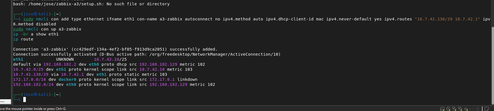

### 7.2 Zabbix en Docker

[`scripts/docker-compose.yml`](scripts/docker-compose.yml) levanta tres contenedores: `zbx-postgres` (PostgreSQL 16), `zbx-server` (Zabbix server 7.0 LTS) y `zbx-web` (interfaz web con Nginx). [`scripts/kali_zabbix_setup.sh`](scripts/kali_zabbix_setup.sh) crea la carpeta `~/zabbix-a3`, genera la clave aleatoria de la base de datos en `.env` y ejecuta `docker compose up -d`.

```
zabbix-web:
  image: zabbix/zabbix-web-nginx-pgsql:alpine-7.0-latest
  ports:
    - "127.0.0.1:8080:8080"      # solo accesible desde el propio Kali
```

Las consultas SNMP salen del contenedor por el NAT de Docker con la IP de la `eth1` (`10.7.42.10`), que es la que permite la ACL (comprobado con `tcpdump`, captura 19).

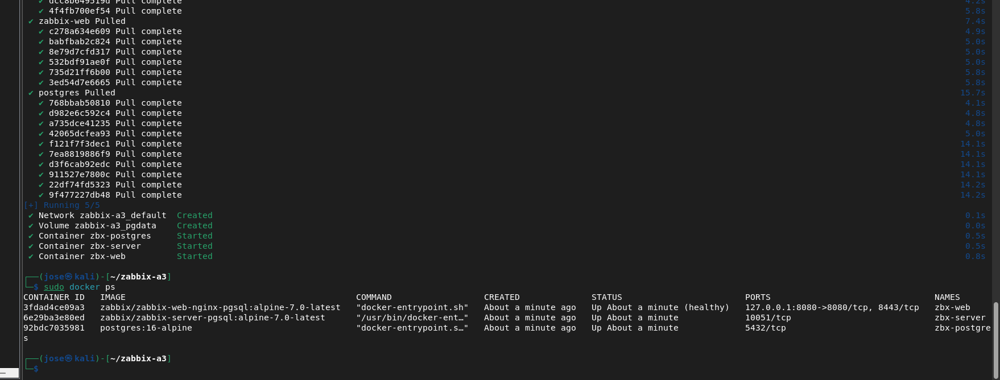

---

## 8. Configuración en Zabbix (GUI)

Todo se hizo en la interfaz web (`http://localhost:8080` en el Kali), versión **7.0.32**:

1. **Entrar con `Admin` y cambiar la clave por defecto:** *User settings → Profile → Change password*.
2. **Comunidad como secreto:** *Administration → Macros* → `{$SNMP_COMMUNITY}` con la comunidad y tipo **Secret text**. Los hosts usan la macro, así que la comunidad nunca se escribe en ellos.
3. **Hosts:** *Data collection → Hosts → Create host*:

| Host | Interfaz SNMP | Versión | Plantilla | Grupo |
|---|---|---|---|---|
| R1 | `10.7.42.1:161` | SNMPv2 · `{$SNMP_COMMUNITY}` | Cisco IOS by SNMP | A3 Red SNMP |
| sw1 | `10.7.42.138:161` | SNMPv2 · `{$SNMP_COMMUNITY}` | Cisco IOS by SNMP | A3 Red SNMP |

4. **Descubrimiento inmediato:** *Discovery → Execute now* en cada host, para que descubra las interfaces sin esperar una hora.
5. Se deshabilitó el host de ejemplo **Zabbix server**, que busca un agente que no existe en esta instalación.

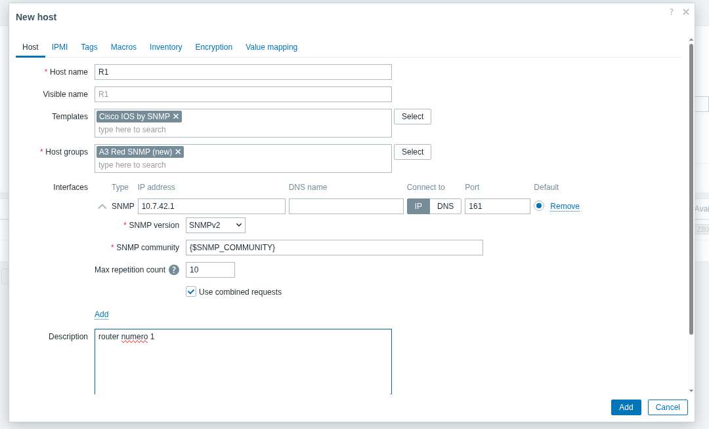
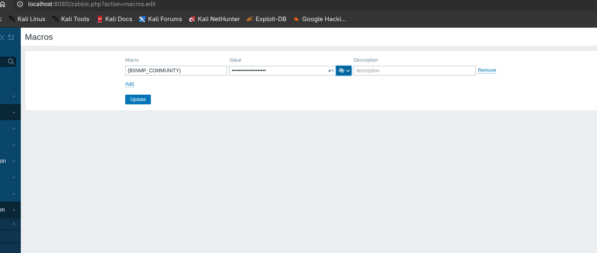

---

## 9. Datos SNMP en Zabbix

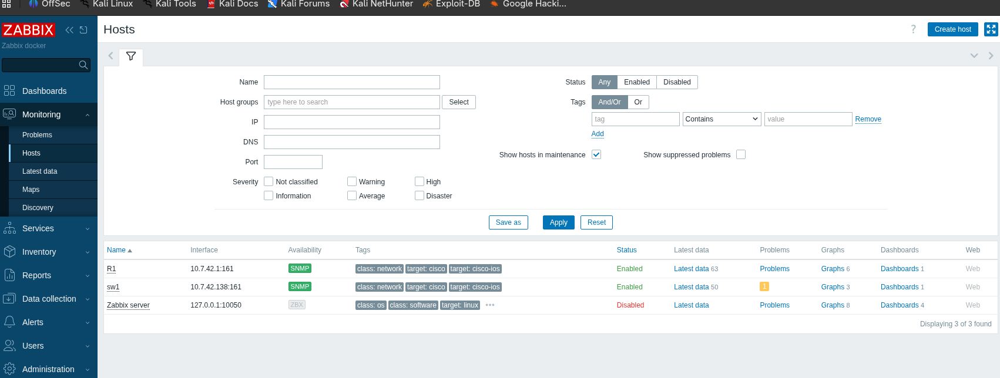

| Dato | R1 | SW1 |
|---|---|---|
| Disponibilidad SNMP | ✅ verde | ✅ verde |
| Valores recogidos | 63 (52 normales) | 50 (47 normales) |
| Interfaces descubiertas | `Et0/0`, `Et0/0.10`, `Et0/0.99`, `Vo0` | `Et0/0`, `Et0/1`, `Vl99` |
| Por interfaz | bits recibidos/enviados, estado, velocidad, errores y descartes | igual |
| Sistema | CPU, memoria, uptime, nombre, modelo, versión de IOS | memoria, uptime, nombre, modelo, versión de IOS |

Las descripciones de las interfaces (`TRUNK-SW1-e0/0`, `VLAN10-LAN`, `SERVIDOR-ZABBIX`...) llegan a Zabbix por SNMP, así que cada gráfica sale con su nombre.

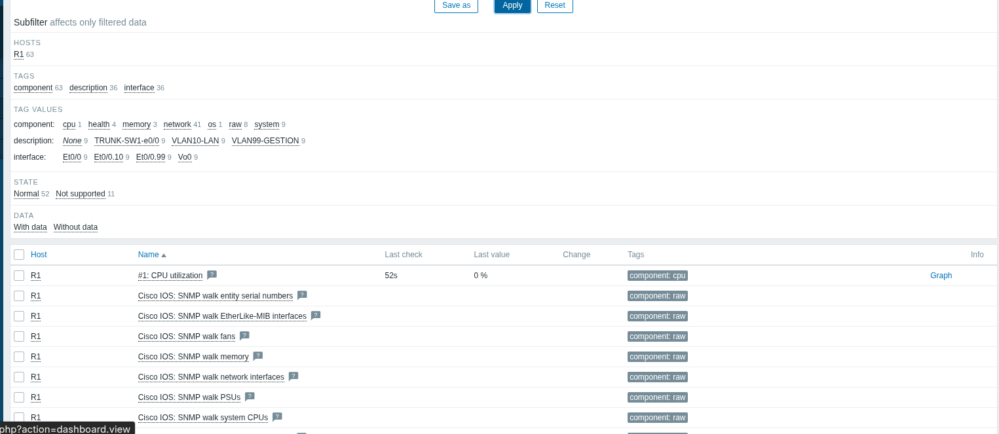
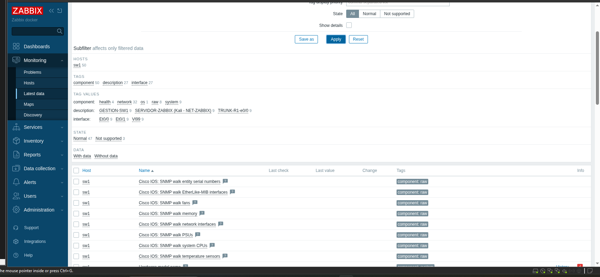
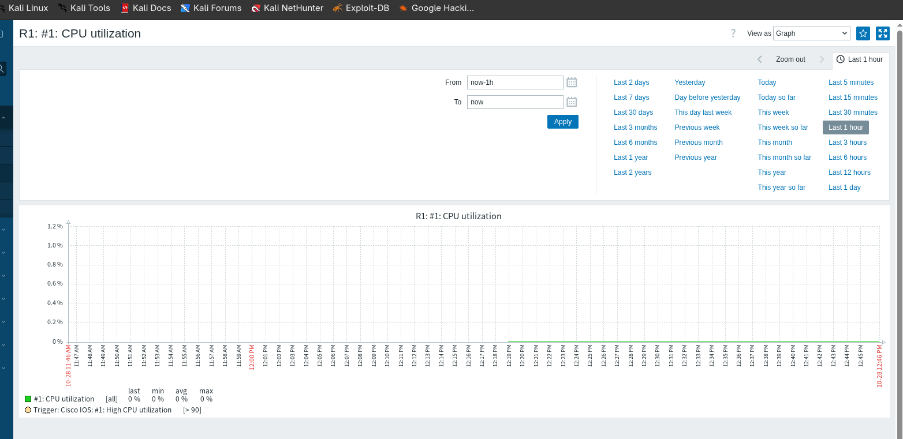
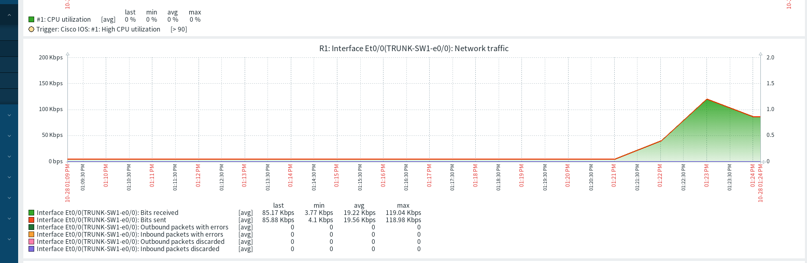

En la gráfica de tráfico se ve el `ping -s 1400` hecho desde el Zabbix hacia el SW1: la `Et0/0` del R1 sube a ~119 Kbps en las dos direcciones, con cero errores y descartes.

---

## 10. Pruebas y Verificación

| # | Prueba | Resultado esperado | Resultado | Evidencia |
|---|---|---|---|---|
| 1 | El Zabbix pide IP por DHCP | `eth1` recibe `10.7.42.10/25` | ✅ | 02 |
| 2 | Reserva en el R1 | `show ip dhcp binding`: `10.7.42.10` · `0100.0c29.a89b.d3` · Manual | ✅ | 15 |
| 3 | SNMP desde el Zabbix (`snmpget`) | R1 y SW1 responden su nombre y versión de IOS | ✅ | 04 |
| 4 | Zabbix recoge los datos | SNMP en verde, interfaces, CPU, memoria y tráfico | ✅ | 07–11 |
| 5 | Escribir con la comunidad correcta (`snmpset`) | `noAccess`: la comunidad es de solo lectura | ✅ | 12 |
| 6 | Comunidad `public` | `Timeout`: no existe | ✅ | 13 |
| 7 | Comunidad correcta desde otra IP (`10.7.42.50`) | `Timeout`: la ACL la bloquea | ✅ | 14 |
| 8 | Registro en el R1 | ACL `deny (6 matches)` · `IPACCESSLOGNP ... denied 10.7.42.50` · `1 Illegal operation` (el `snmpset`) | ✅ | 16 |
| 9 | Sin administración por red en el SW1 | `no ip http server` · `transport input none` | ✅ | 17 |

Las pruebas 5 a 7 se hicieron desde la terminal del Kali con la comunidad guardada en una variable (`read -rs COM`) para que no aparezca en pantalla.

---

## 11. Problemas Encontrados y Soluciones

### 11.1 El bloque de instalación no se pegó completo
El bloque largo que creaba `setup.sh` se cortó al pegarlo en la terminal del Kali (VMware) y dio `setup.sh: No such file or directory`. **Solución:** pegarlo en tres bloques cortos: crear la carpeta, crear `docker-compose.yml` y levantar los contenedores.

### 11.2 SNMP en rojo en Zabbix: comunidad equivocada
Zabbix marcaba `cannot retrieve OID ... timed out`. Para saber si era la red o la comunidad:
- `tcpdump -ni eth1 udp port 161` en el Kali: las consultas `GetBulk` salían desde `10.7.42.10` (el NAT de Docker usa la IP correcta) y no volvía ninguna respuesta.
- `show snmp` en el R1: `340 SNMP packets input` y `339 Unknown community name`.

O sea, la red estaba bien y la macro `{$SNMP_COMMUNITY}` tenía otro valor. La ACL solo contaba 2 coincidencias porque IOS descarta la comunidad desconocida antes de evaluar la ACL. **Solución:** volver a escribir la comunidad en la macro, sin espacios, y después pasarla a *Secret text*. En el historial de problemas de Zabbix quedan los dos `No SNMP data collection` como **RESOLVED**.

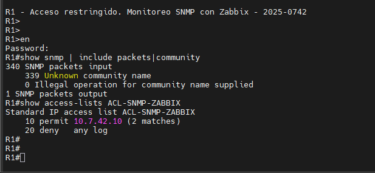
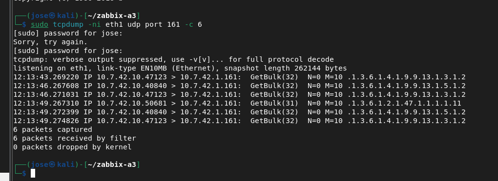
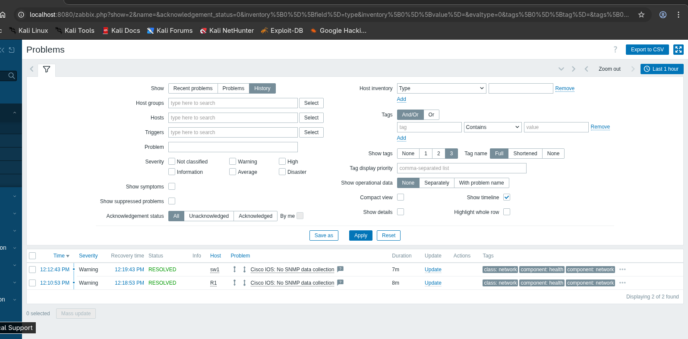

### 11.3 El host de ejemplo de Zabbix
El host **Zabbix server** que trae la instalación daba `Zabbix agent is not available` (no hay agente en los contenedores). Se deshabilitó, porque no forma parte de la asignación.

### 11.4 El SW1 traía el servidor HTTP encendido
La running-config del SW1 mostró `ip http server` (valor de fábrica de la imagen L2). Se apagó con `no ip http server` y se cerraron las VTY con `transport input none`.

### 11.5 Nombre del nodo del switch
El switch se creó en PNETLab como "R2" y en Zabbix como "sw 1". Se renombró el nodo y el host a `sw1`; el hostname del equipo es `SW1`.

---

## 12. Scripts y Running-Configs

| Archivo | Contenido |
|---|---|
| [`scripts/R1_config.txt`](scripts/R1_config.txt) | R1: direccionamiento, DHCP con reserva, SNMP RO con ACL y registros |
| [`scripts/SW1_config.txt`](scripts/SW1_config.txt) | SW1: VLAN, trunk, port-security, gestión y SNMP RO con ACL |
| [`scripts/kali_red_dhcp.sh`](scripts/kali_red_dhcp.sh) | Perfil DHCP de la `eth1` del Kali (servidor Zabbix) |
| [`scripts/kali_zabbix_setup.sh`](scripts/kali_zabbix_setup.sh) | Instalación de Zabbix con Docker en el Kali |
| [`scripts/docker-compose.yml`](scripts/docker-compose.yml) | Contenedores de Zabbix server, Zabbix web y PostgreSQL |
| [`running-configs/R1_running-config.txt`](running-configs/R1_running-config.txt) | `show running-config` final del R1 |
| [`running-configs/SW1_running-config.txt`](running-configs/SW1_running-config.txt) | `show running-config` final del SW1 |

Los scripts usan marcadores (`<CLAVE_ENABLE>`, `<COMUNIDAD_SNMP>`) en lugar de los valores reales, y en las running-configs se reemplazaron por `<OCULTO>`.

---

## 13. Evidencias (Capturas)

| # | Captura | Qué muestra |
|---|---|---|
| 01 | [Topología PNETLab](screenshots/01_topologia_pnetlab.png) | R1, SW1 y la nube NET-ZABBIX |
| 02 | [Kali por DHCP](screenshots/02_kali_eth1_cliente_dhcp.png) | `eth1` con `10.7.42.10/25` y sus rutas |
| 03 | [Contenedores](screenshots/03_kali_docker_zabbix_contenedores.png) | `zbx-postgres`, `zbx-server` y `zbx-web` en *Up* |
| 04 | [snmpget](screenshots/04_kali_snmpget_r1_sw1.png) | R1 y SW1 responden por SNMP |
| 05 | [Host R1](screenshots/05_zabbix_host_r1_interfaz_snmp.png) | Interfaz SNMPv2 con `{$SNMP_COMMUNITY}` y la plantilla |
| 06 | [Macro secreta](screenshots/06_zabbix_macro_comunidad_secreta.png) | La comunidad como *Secret text* |
| 07 | [Hosts](screenshots/07_zabbix_hosts_snmp_disponible.png) | R1 y SW1 con SNMP en verde |
| 08 | [Latest data R1](screenshots/08_zabbix_latest_data_r1.png) | 63 valores, interfaces y CPU |
| 09 | [Latest data SW1](screenshots/09_zabbix_latest_data_sw1.png) | 50 valores e interfaces |
| 10 | [CPU R1](screenshots/10_zabbix_grafica_cpu_r1.png) | Gráfica de CPU |
| 11 | [Tráfico R1](screenshots/11_zabbix_trafico_et0_0_r1.png) | Tráfico de `Et0/0` |
| 12 | [snmpset](screenshots/12_kali_snmpset_noaccess_solo_lectura.png) | `noAccess`: solo lectura |
| 13 | [public](screenshots/13_kali_snmpget_public_timeout.png) | `Timeout` con la comunidad por defecto |
| 14 | [Otra IP](screenshots/14_kali_snmpget_otra_ip_timeout.png) | `Timeout` desde `10.7.42.50` |
| 15 | [DHCP binding](screenshots/15_r1_dhcp_binding_zabbix.png) | Reserva `10.7.42.10` entregada |
| 16 | [ACL y log](screenshots/16_r1_acl_snmp_y_log_denegado.png) | `deny` con coincidencias y el registro del bloqueo |
| 17 | [SW1 sin HTTP](screenshots/17_sw1_sin_http_y_vty_cerradas.png) | `no ip http server` y VTY cerradas |
| 18 | [Unknown community](screenshots/18_problema_r1_unknown_community.png) | Diagnóstico del problema 11.2 |
| 19 | [tcpdump](screenshots/19_problema_kali_tcpdump_snmp.png) | Consultas SNMP saliendo desde `10.7.42.10` |
| 20 | [Problemas resueltos](screenshots/20_problema_zabbix_no_snmp_resuelto.png) | `No SNMP data collection` → RESOLVED |

---

## 14. Notas y Limitaciones del Laboratorio

- **Abanicos, fuentes y temperatura:** la plantilla *Cisco IOS by SNMP* los pide, pero los equipos IOL de PNETLab son virtuales y no tienen sensores; por eso esos valores salen como *Not supported*, junto con otros datos que la imagen no publica (11 en el R1 y 3 en el SW1). En un equipo físico aparecerían en la misma plantilla.
- **CPU del SW1:** la imagen IOL L2 no publica la MIB de CPU de Cisco, así que en el SW1 no hay gráfica de CPU.
- **SNMPv2c:** la comunidad viaja en texto plano dentro del paquete; por eso se combina con la ACL y con una VLAN de gestión. En producción se recomienda SNMPv3 con autenticación y cifrado (`authPriv`).
- **Claves:** la comunidad SNMP, la clave enable, la clave de `Admin` de Zabbix y la de PostgreSQL no están en este repositorio.
- **RAM:** Zabbix y PostgreSQL ocupan cerca de 1 GB dentro del Kali; con 1.5 GB la VM queda justa, así que se recomienda darle 3 GB. El Windows Server de otras asignaciones no se usa en esta.
- **MAC sticky en SW1 `e0/1`:** además de la `eth1` del Kali aparece la MAC de la VM de PNETLab que forma el puente de la nube; por eso el máximo de port-security es 4.
